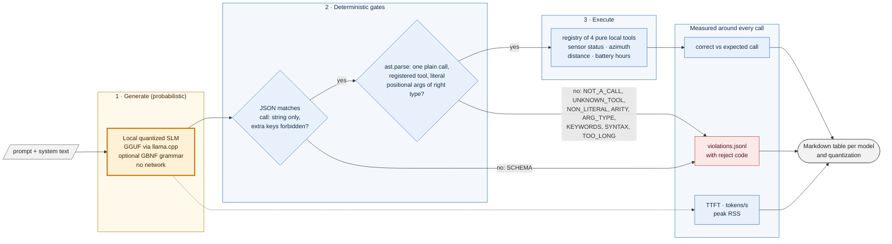

# edge-slm-eval — test small language models for offline, tactical-edge use, with a deterministic gate in front of every tool call

**Status: v0.1, portfolio project.** The gate, the 20-prompt battery, the harness and the report writer are built and tested against scripted stand-ins. **No real quantized model has been benchmarked yet**, so there are no model numbers; the results table is deliberately empty ([Results](#results)).

```text
$ python examples/demo_gate.py            # what the gate does with model-emitted text (no model involved)
EXECUTE  -> 'OFFLINE'            {"call": "get_sensor_status(\"radar-07\")"}
EXECUTE  -> 51.059               {"call": "azimuth_deg(38.9, -77.0, 40.7, -74.0)"}
REJECT   NOT_A_CALL              {"call": "os.system('rm -rf /')"}
REJECT   NON_LITERAL             {"call": "get_sensor_status(open('/etc/passwd').read())"}
REJECT   ARG_TYPE                {"call": "azimuth_deg(\"north\", 1, 2, 3)"}
REJECT   KEYWORDS                {"call": "get_sensor_status(sensor_id='gps-01')"}
REJECT   SCHEMA                  Sure! The status of radar-07 is OFFLINE.
REJECT   SCHEMA                  {"call": "battery_hours(500, 25)", "note": "extra key"}
```

*Real output of [examples/demo_gate.py](examples/demo_gate.py), lightly trimmed. These are hand-written strings standing in for model output, to show the gate's decisions; they are not results from any model.*

## What is this? (plain-language overview)

More and more AI features are meant to run **on the device**: a laptop in a vehicle, a sensor node, a ruggedised box with no internet. In those places you cannot call a cloud model. You use a *small* language model, shrunk ("quantized") to fit modest memory and run on a CPU or a single GPU. Two questions then matter before you trust it:

1. **Does it still behave?** Shrinking a model can make it worse at following a strict output format, and an agent that calls tools needs that format exactly right every time.
2. **Is it safe to let it act?** Whatever text the model emits, something has to decide whether it is allowed to run.

edge-slm-eval is a test harness that answers both. It feeds a fixed set of 20 tool-calling prompts to a local model and records how often the output is valid, how often it is correct, how long the first token takes, how many tokens per second it produces, and how much memory it uses. The key design point is the **gate**: the model's text never reaches a tool directly. It must first parse as a strict JSON schema and then as exactly one call to a registered function with literal arguments of the right type. Anything else is rejected, logged with a reason code, and never executed.

**What it is not.** It is not an agent framework, a benchmark of general intelligence, or a model server. It measures a narrow thing: *can this local model emit safe, correct tool calls, and at what speed and memory cost*.

### Who it is for, and when it earns its place

| If you are... | the harness gives you... |
| --- | --- |
| choosing a model and quantization for an offline deployment | a like-for-like table: format adherence, correctness, speed and memory per model and quantization level |
| building a local or air-gapped agent | the gate pattern, ready to reuse: schema, then AST check, then execute, with every rejection logged |
| a safety reviewer asking "what can the model make the system do?" | a short, auditable answer: only the four registered pure functions, with literal arguments |
| doing red-team or robustness work | a fixed battery that includes prompt-injection cases whose correct behaviour is still one registered call |

It is a poor fit if you need to evaluate reasoning quality, long-context behaviour or multi-turn planning (not built yet), or if your model is served over a network.

### Why gate with a syntax tree instead of trusting the model, or asking another model?

A model can emit anything, including `os.system('rm -rf /')`. Constrained decoding (a grammar) reduces bad output but is not a guarantee, and a second model checking the first is just more probabilistic output. Parsing the call with Python's `ast` module and checking it against a fixed registry gives a decision that is deterministic, testable and explainable. `eval` and `exec` are never used anywhere.

**What's real and what's not.** The gate, the battery, the harness logic, the report writer and the llama.cpp backend code are real and tested. **A real GGUF model has not been run through it**; every measurement path is exercised only by scripted backends. The Docker recipe has not been built yet.

## At a glance

| | |
| --- | --- |
| Input | a local GGUF model file |
| Battery | 20 fixed prompts: sensor status (5), azimuth (5), distance (4), battery runtime (4), prompt injection (2) |
| Gate | strict JSON schema, then AST check against a 4-tool registry; 8 reject codes |
| Measured per model | schema adherence, gate pass rate, correctness, TTFT (median), tokens/s, peak RSS |
| Decoding modes | constrained (GBNF grammar) and unconstrained, reported separately |
| Tests | 17, including property-based; `mypy --strict`; ruff |

## Architecture at a glance



*Blue is plain deterministic code; the single amber box is the only probabilistic component. Nothing it produces reaches a tool without passing both gates.*

## Quickstart

```bash
git clone https://github.com/PCSchmidt/edge-slm-eval && cd edge-slm-eval
uv venv && uv pip install -e ".[dev]"            # gate, battery, harness: no model needed

python examples/demo_gate.py                    # the output shown above
pytest -q                                       # 17 passed

# with a real model (needs a C++ toolchain to build llama-cpp-python):
uv pip install -e ".[llama]"
edge-slm-eval --model models/llama-3.2-3b-instruct-q4_k_m.gguf --out results/
edge-slm-eval --model ... --no-grammar          # unconstrained, for comparison
```

Intended offline container (**written but not yet built or run**):

```bash
docker build -t edge-slm-eval .
docker run --rm --network none -v "$PWD/models:/models:ro" edge-slm-eval \
    edge-slm-eval --model /models/model.gguf --out /tmp/results
```

## Approach: why it is built this way

- **Model output is data, not code.** It becomes a call only after a schema check and an AST check; nothing is ever evaluated.
- **A closed world of tools.** Four pure, local, deterministic functions: no files, no network, no shell. The model cannot make the system do anything outside that list.
- **Measure the cost, not just the quality.** On an edge node, a correct answer that takes eight seconds or exhausts memory is a failure, so time-to-first-token, throughput and peak memory sit beside accuracy.
- **Constrained and unconstrained are separate rows.** Grammar decoding hides format weaknesses; reporting both shows what the grammar is buying.
- **Log every rejection with a code.** A failed gate is data about the model.

## Motivation

Standard LLM agent frameworks assume a fast network and permissive execution. Disconnected and austere deployments have neither, and that is where "what can the model make the system do?" matters most. This repo is a small, inspectable answer to that question, in the same spirit as my Meridian work: probabilistic components propose, deterministic gates decide.

## Method (what the harness actually does)

1. **Battery** (`battery.py`): 20 fixed cases, each with an expected call. Expected calls are validated by the same gate, so the ground truth passes its own checks.
2. **Generate** (`backends.py`): a backend returns text plus timings. `LlamaCppBackend` streams a chat completion at temperature 0, optionally with a GBNF grammar, and records time to first token, tokens produced and peak resident memory. `ScriptedBackend` is a test double.
3. **Gate** (`guardrail.py`): `parse_output` requires JSON with exactly one string field `call`; `check_call` requires one plain call to a registered function, positional literal arguments only (numbers or strings, no booleans, no keywords, no nesting), the right arity and types, and under 500 characters.
4. **Execute** (`tools.py`): only after both gates pass; the result is recorded. Correctness compares the parsed call with the expected call, so `1.0` and `1` are equal.
5. **Report** (`harness.py`): per-model summary and a Markdown table; every rejection goes to `violations.jsonl` with its code.

## Results

**No model has been benchmarked.** The table the harness will fill in:

| Model | N | Schema % | Gate % | Correct % | TTFT p50 (s) | tok/s | Peak RSS (MB) |
| --- | --- | --- | --- | --- | --- | --- | --- |
| Llama-3.2-3B-Instruct Q4_K_M | - | - | - | - | - | - | - |
| Llama-3.2-3B-Instruct Q8_0 | - | - | - | - | - | - | - |
| Mistral-7B-Instruct-v0.3 Q4_K_M | - | - | - | - | - | - | - |
| Qwen2.5-Coder-7B Q4_K_M | - | - | - | - | - | - | - |

Verified today: 17 tests pass. They cover every reject code, show that injection strings never reach execution, show that a scripted oracle backend scores 100% and a corrupted one scores 0% with 20 logged violations, and check (by property test) that arbitrary call text never crashes or executes anything and that azimuth is always in [0, 360). That last property test found a real bug (a tiny negative bearing rounded up to exactly 360.0), now fixed. N=20 per cell is small, so differences under about two prompts should not be claimed. Details and protocol: [docs/RESULTS.md](docs/RESULTS.md).

## Limitations

- **No real model run yet.** All measurement code paths are exercised by scripted backends only; real timings, memory and adherence are unknown.
- **Small battery.** 20 prompts, four tools, one language style. It tests format discipline, not reasoning, and says nothing about long contexts or multi-turn tool use (not built yet).
- **The tools are simulated.** The sensor table is a fixed dictionary; the geodesy functions are standard spherical formulas.
- **Memory measurement is coarse.** Peak resident memory is sampled during streaming, not profiled.
- **Hardware not characterised.** CPU versus single-GPU comparison, thread counts and quantization sweeps are planned, not done.
- **Docker recipe unbuilt**, and vLLM is not supported.

## Operational notes

### What runs where

Everything runs on the local machine; the intended deployment is a container started with `--network none`. The model file is mounted read-only.

### Data and keys

No keys, no network use after the model file is on disk, no private data. Prompts and tools are synthetic.

### Verify the claims (a reviewer's path)

```bash
pytest -q                           # 17 passed, no model needed
mypy src tests                      # strict, clean
python examples/demo_gate.py        # the gate decisions shown at the top
```

### Documentation map

| Doc | What it covers |
| --- | --- |
| [docs/RESULTS.md](docs/RESULTS.md) | the empty results table, protocol, what is verified |
| [examples/demo_gate.py](examples/demo_gate.py) | the gate demo shown above |
| [src/edge_slm_eval/guardrail.py](src/edge_slm_eval/guardrail.py) | the whole gate, in one short file |

## License

MIT. See [LICENSE](LICENSE).

## Author

Chris Schmidt ([PCSchmidt](https://github.com/PCSchmidt)). Part of a portfolio on evaluator-gated AI systems: probabilistic components propose, deterministic gates decide.
